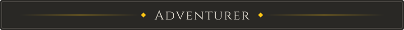
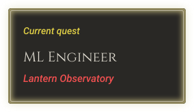
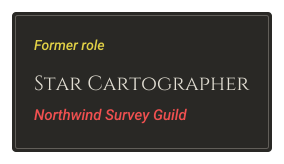
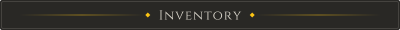
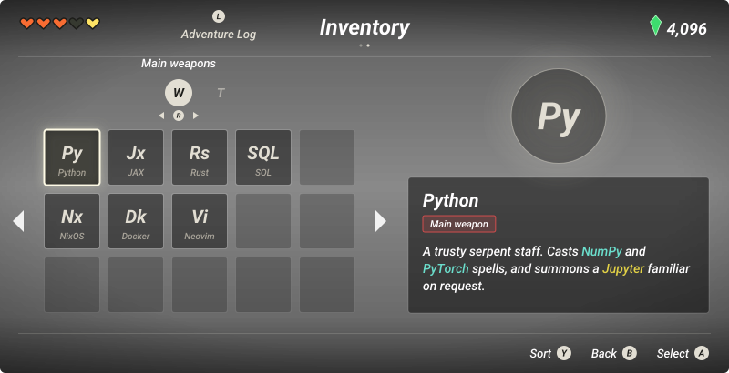
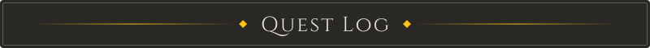
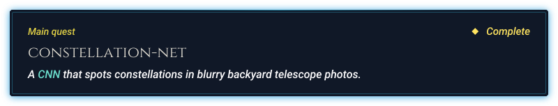
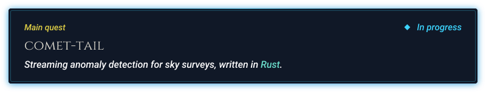
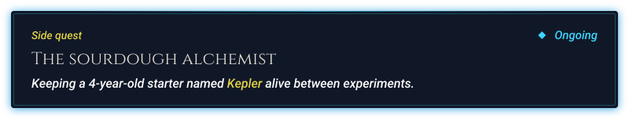

<!-- Gerado por tools/build.py. Não edite à mão: edite o script e rode de novo. -->

# GitHub profile builder

A Python script that renders a GitHub profile README as a set of SVG images styled after an
open-world adventure game HUD: hearts and a stamina wheel, a dialogue box, item cards,
an inventory grid, a quest log and a "send message?" prompt.

The **Result** section below is the real output of [`tools/build.py`](tools/build.py), rendered
from the placeholder `EXAMPLE` profile. This README is generated by the same script, so the
preview is always up to date.

## Result

<p align="center"></p>

<p align="center"></p>

<p align="center">



</p>

<p align="center"></p>

<p align="center"></p>

<p align="center"></p>

<p align="center"></p>
<p align="center"></p>
<p align="center"></p>

<p align="center"><a href="mailto:wren@example.com"></a></p>

<p align="center"></p>

<p align="center"><sub><i>May your gradients never vanish, traveler.</i></sub></p>

---

## How it works

GitHub strips CSS, fonts and scripts from READMEs, but it renders SVG images. `build.py`
draws every section as a standalone SVG and converts all text to vector outlines
(`<path>`) with [fontTools](https://github.com/fonttools/fonttools), using the fonts in
[`tools/fonts/`](tools/fonts). The images look the same in any browser, on light and dark
themes, with nothing installed on the viewer's side.

Because the text is baked into the images, **never edit the SVGs by hand**: change the
`PROFILE` dictionary at the top of `build.py` and run the script again.

## Quick start

```sh
python3 -m venv venv
venv/bin/pip install fonttools
venv/bin/python tools/build.py
```

This writes:

| File | Contents |
| --- | --- |
| `assets/hero.svg` | Hearts, stamina wheel and the greeting dialogue box |
| `assets/title-adventurer.svg` | Section title "Adventurer" |
| `assets/title-inventory.svg` | Section title "Inventory" |
| `assets/title-quests.svg` | Section title "Quest Log" |
| `assets/inventory.svg` | Item grid with a detail panel for the selected item |
| `assets/contact.svg` | "Send message?" prompt with the e-mail link |
| `assets/divider.svg` | Ornamental divider above the footer |
| `assets/card-degree.svg` | Card: Degree |
| `assets/card-current.svg` | Card: Current quest |
| `assets/card-former.svg` | Card: Former role |
| `assets/quest-1.svg` | Quest log entry: main quest "constellation-net" |
| `assets/quest-2.svg` | Quest log entry: main quest "comet-tail" |
| `assets/quest-side.svg` | Quest log entry: side quest "The sourdough alchemist" |
| `PROFILE.md` | The profile page built from `PROFILE`, ready to be used as a profile README |
| `assets/example/` | The same images built from `EXAMPLE`, used only by the preview above |
| `README.md` | This document |

## Customizing

Edit `PROFILE` in [`tools/build.py`](tools/build.py). `EXAMPLE` has the same keys and only
feeds the preview in this README:

| Key | What it controls | Example value |
| --- | --- | --- |
| `name`, `greeting` | Dialogue box in the hero | `Wren Halloway` |
| `hearts` | Hearts in the top-left: `full`, `empty` and yellow `bonus` | 3 full, 1 empty, 1 bonus |
| `stamina` | Fill of the stamina wheel, from 0 to 1 | `0.4` |
| `cards` | The three cards under "Adventurer"; `selected` adds a glow | 3 cards |
| `inventory` | Rows of item slots; the `selected` item fills the side panel | 7 items |
| `quests` | Quest log entries; `status` is `Complete`, `In progress` or `Ongoing` | 3 quests |
| `contact` | E-mail and button labels of the message prompt | |
| `footer` | Line at the very bottom | |

Text fields accept inline color markup:

| Markup | Meaning | Color |
| --- | --- | --- |
| `[i:text]` | item / keyword | `#6BDECC` |
| `[l:text]` | place | `#F15050` |
| `[y:text]` | highlight | `#E2D146` |

Colors live in the `C` dictionary. The heart shape and its color come from the heart SVG
in `assets/`, so replacing that file changes every heart on the next build.

## Using it as your GitHub profile

GitHub shows a profile README from a public repository named exactly like your username.
Copy `PROFILE.md` (renamed to `README.md`) and the `assets/` folder into that repository,
or fork this project into it and point `build.py` to write the profile to `README.md`.

## Project layout

```
assets/          generated SVGs for your profile (plus the heart shape used as input)
assets/example/  generated SVGs for the README preview
tools/build.py   content, styles and the generator
tools/fonts/     Cinzel and Roboto, with their licenses
PROFILE.md       generated profile page
README.md        generated documentation (this file)
```

## Credits

- Fonts: [Cinzel](https://github.com/NDISCOVER/Cinzel) and [Roboto](https://github.com/googlefonts/roboto-classic),
  both under the SIL Open Font License (see `tools/fonts/`).
- The HUD style is a fan tribute to *The Legend of Zelda: Breath of the Wild / Tears of the Kingdom*.
  This project is not affiliated with or endorsed by Nintendo.
