<!-- Gerado por tools/build.py. Não edite à mão: edite o script e rode de novo. -->

# GitHub profile builder

A Python script that renders a GitHub profile README as a set of SVG images styled after an
open-world adventure game HUD: hearts and a stamina wheel, a dialogue box, a game menu with
an Adventure Log (your roles and degrees, as quests) and an Inventory (your tools).

The **Result** section below is the real output of [`tools/build.py`](tools/build.py), rendered
from the placeholder `EXAMPLE` profile. This README is generated by the same script, so the
preview is always up to date.

## Result

<p align="center"></p>

<p align="center"></p>

<p align="center"></p>

<p align="center"><sub><a href="https://example.com/lantern-observatory">ML Engineer</a> · <a href="https://example.com/duskwater-university">B.S. in Astrophysics</a> · <a href="https://example.com/northwind-guild">Former Star Cartographer</a></sub></p>

<p align="center"></p>

---

## How it works

GitHub strips CSS, fonts and scripts from READMEs, but it renders SVG images. `build.py`
draws every section as a standalone SVG and converts all text to vector outlines
(`<path>`) with [fontTools](https://github.com/fonttools/fonttools), using the fonts in
[`tools/fonts/`](tools/fonts). The images look the same in any browser, on light and dark
themes, with nothing installed on the viewer's side.

The menu's "tabs" are an SVG animation (SMIL): GitHub plays it inside the ``, so each
screen slides into the next every few seconds without any JavaScript. Viewers that don't
run SVG animation see the first screen. Each tab is also written as a still image
(`menu-quests.svg`, `menu-inventory.svg`); set `MENU_ANIMATED = False` in
`build.py` to show those stacked instead of the animation.

Because the text is baked into the images, **never edit the SVGs by hand**: change your
profile dictionary and run the script again.

## Quick start

```sh
python3 -m venv venv
venv/bin/pip install fonttools
venv/bin/python tools/build.py
```

This always writes `README.md` (this document) and the example images in `assets/example/`.
If `tools/my_profile.py` exists (see [Customizing](#customizing)), it also writes **your**
profile to `me/`: `me/PROFILE.md` plus its images in `me/assets/`. Both `tools/my_profile.py`
and `me/` are in `.gitignore`, so your personal data never ends up in this repository.

Each profile build makes these images:

| File | Contents |
| --- | --- |
| `hero.svg` | Hearts, stamina wheel and the greeting dialogue box |
| `menu.svg` | Animated game menu that switches between Adventure Log and Inventory |
| `menu-quests.svg` | Menu tab Adventure Log, as a still image |
| `menu-inventory.svg` | Menu tab Inventory, as a still image |
| `divider.svg` | Ornamental divider, used under the intro and at the bottom |

## Customizing

Create `tools/my_profile.py` with a `PROFILE` dictionary. The easiest start is to copy the
`EXAMPLE` dictionary from [`tools/build.py`](tools/build.py) and rename it:

```python
# tools/my_profile.py  (ignored by git)
PROFILE = {
    "name": "Your Name",
    "greeting": "Hi! I'm a [i:developer] at [l:Some Place].",
    # ...same keys as EXAMPLE
}
```

These are the keys:

| Key | What it controls | Example value |
| --- | --- | --- |
| `name`, `greeting` | Dialogue box in the hero | `Wren Halloway` |
| `hearts` | Hearts in the top-left: `full`, `empty` and yellow `bonus` | 3 full, 1 empty, 1 bonus |
| `stamina` | Fill of the stamina wheel, from 0 to 1 | `0.4` |
| `inventory` | Item categories (one tab each) and their items, 5 per row; the `selected` item fills the showcase and description panel. A category's tab shows `tab_image` (an image in `tools/icons/`) or a one-letter `icon` | 1 category, 7 items |
| `gems` | Optional counter in the inventory's top-right corner | 4096 |
| `quests` | Adventure Log entries (your roles and degrees), in list order; `selected` picks the one shown in the panel, `where` extends the legend, `link` adds it to the link line under the menu (`link_label` changes its text), `status` is `Complete`, `In progress` or `Ongoing` | 3 entries |
| `footer` | Optional line at the very bottom | |

Text fields accept inline color markup:

| Markup | Meaning | Color |
| --- | --- | --- |
| `[i:text]` | item / keyword | `#6BDECC` |
| `[l:text]` | place | `#F15050` |
| `[y:text]` | highlight | `#E2D146` |

Colors live in the `C` dictionary. The heart shape and its color come from the heart SVG
in `assets/`, so replacing that file changes every heart on the next build.

## Icons

Icons live in [`tools/icons/`](tools/icons) and are drawn straight into the SVGs, so the build
never needs the internet. There are two kinds:

- **Item icons** (the colored tiles in the inventory slots). Set an item's `icon` to the file
  name without `.svg`, for example `{"glyph": "Py", "icon": "py", "name": "Python"}`.
  If the file doesn't exist or `icon` is missing, the slot shows the item's `glyph` text instead.
- **Tab images** (the symbol inside a category's round tab, like the sword on "Weapons"). Set the
  category's `tab_image` to a file in `tools/icons/`, for example `"tab_image": "tab-weapons.png"`.
  Use a **white** shape on a transparent background (PNG or SVG): the build recolors it dark on
  the selected tab and light gray on the others. Keep the file small (around 96×96 px is plenty).

### Adding a new item icon

Item icons come from [skillicons.dev](https://skillicons.dev) (see the list of IDs there).

1. Download the icon, using the dark theme:

   ```sh
   curl -s "https://skillicons.dev/icons?i=vscode&theme=dark" -o vscode-download.svg
   ```

2. Strip the wrapper. The downloaded file wraps the real icon in an extra `<svg>` and `<g>`:

   ```xml
   <svg width="48" height="48" viewBox="0 0 256 256" ...>        <- remove
       <g transform="translate(0, 0)">                          <- remove
         <svg xmlns="http://www.w3.org/2000/svg" width="256" ...>  <- keep from here
           ...
         </svg>                                                  <- ...to here
       </g>                                                      <- remove
   </svg>                                                        <- remove
   ```

   `build.py` expects only the inner `<svg>...</svg>` (256×256). You can delete the outer
   lines by hand in any editor, or run this to do it:

   ```sh
   python3 -c "import re, sys; t = open(sys.argv[1]).read(); open(sys.argv[2], 'w').write(re.search(r'<g transform=\"translate\(0, 0\)\">\s*(<svg.*?</svg>)\s*</g>', t, re.S).group(1) + '\n')" vscode-download.svg tools/icons/vscode.svg
   ```

3. Use it in your profile: `{"glyph": "VS", "icon": "vscode", "name": "VS Code"}`, then run
   `venv/bin/python tools/build.py`.

## Using it as your GitHub profile

GitHub shows a profile README from a public repository named exactly like your username.
Copy `me/PROFILE.md` (renamed to `README.md`) and the `me/assets/` folder into that
repository. The image paths in `PROFILE.md` are relative (`./assets/...`), so they keep working
as long as both go to the root of the repository.

## Project layout

```
assets/              the heart shape used as input
assets/example/      generated SVGs for the README preview
tools/build.py       example profile, styles and the generator
tools/my_profile.py  your profile (you create it; ignored by git)
tools/fonts/         Cinzel and Roboto, with their licenses
tools/icons/         item icons and tab images
me/                  your generated profile page and images (ignored by git)
README.md            generated documentation (this file)
```

## Credits

- Fonts: [Cinzel](https://github.com/NDISCOVER/Cinzel) and [Roboto](https://github.com/googlefonts/roboto-classic),
  both under the SIL Open Font License (see `tools/fonts/`).
- Item icons: [Skill Icons](https://github.com/tandpfun/skill-icons) by tandpfun, MIT License
  (see `tools/icons/` and the [Icons](#icons) section).
- The HUD style is a fan tribute to *The Legend of Zelda: Breath of the Wild / Tears of the Kingdom*.
  This project is not affiliated with or endorsed by Nintendo.
